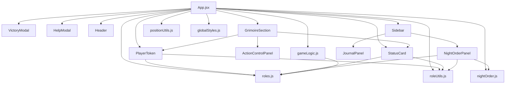

# 🗂️ Structure Complète du Projet

## 📊 Vue d'ensemble

```
blood-on-the-clocktower-grimoire/
│
├── 📁 public/
│   └── images/
│       ├── day.png
│       ├── night.png
│       └── roles/
│           ├── Icon_washerwoman.png
│           ├── Icon_librarian.png
│           ├── Icon_investigator.png
│           └── ... (tous les autres rôles)
│
├── 📁 src/
│   │
│   ├── 📁 data/                    ✅ CRÉÉ
│   │   ├── roles.js                     # Définitions des rôles
│   │   └── nightOrder.js                # Ordre des phases
│   │
│   ├── 📁 utils/                   ✅ CRÉÉ
│   │   ├── roleUtils.js                 # Utilitaires rôles
│   │   ├── gameLogic.js                 # Logique métier
│   │   └── positionUtils.js             # Calcul positions
│   │
│   ├── 📁 styles/                  ✅ CRÉÉ
│   │   └── globalStyles.js              # Styles globaux
│   │
│   ├── 📁 components/              ⏳ EN COURS
│   │   ├── PlayerToken.jsx          ✅  # Token joueur
│   │   ├── StatusCard.jsx           ✅  # Carte statut
│   │   ├── VictoryModal.jsx         ✅  # Modal victoire
│   │   ├── HelpModal.jsx            ✅  # Modal aide
│   │   ├── Header.jsx               ✅  # En-tête
│   │   ├── ActionControlPanel.jsx   ⏳  # Contrôles action
│   │   ├── GrimoireSection.jsx      ⏳  # Section grimoire
│   │   ├── Sidebar.jsx              ⏳  # Barre latérale
│   │   ├── NightOrderPanel.jsx      ⏳  # Ordre de nuit
│   │   └── JournalPanel.jsx         ⏳  # Journal
│   │
│   ├── App.jsx                      ⏳  # Composant racine
│   ├── index.js                         # Point d'entrée
│   └── index.css                        # Styles de base
│
├── 📁 docs/                        ✅ CRÉÉ
│   ├── README.md                        # Vue d'ensemble
│   ├── SUMMARY.md                       # Résumé progression
│   ├── EXTRACTION_GUIDE.md              # Guide extraction
│   └── TEMPLATES.md                     # Templates composants
│
├── package.json
├── .gitignore
└── README.md
```

## 📈 Progression par dossier

### ✅ data/ - 100% (2/2)
```
✅ roles.js           - Tous les rôles (Villageois, Étrangers, Sbires, Démons)
✅ nightOrder.js      - Ordre des phases (first, other, day)
```

### ✅ utils/ - 100% (3/3)
```
✅ roleUtils.js       - getRoleCategory, getCategoryColor, getActionType
✅ gameLogic.js       - assignRoles, checkVictoryConditions, canUseAbility
✅ positionUtils.js   - calculateCirclePositions, calculateNewPlayerPosition
```

### ✅ styles/ - 100% (1/1)
```
✅ globalStyles.js    - Animations, responsive, scrollbars, keyframes
```

### ⏳ components/ - 30% (3/10)
```
✅ PlayerToken.jsx           - 100% - Drag & drop, tactile, affichage
✅ StatusCard.jsx            - 100% - Édition joueur, sélection rôle
✅ VictoryModal.jsx          - 100% - Fin de partie
⏳ HelpModal.jsx             -   0% - À extraire (~330 lignes)
⏳ Header.jsx                -   0% - À extraire (~120 lignes)
⏳ ActionControlPanel.jsx    -   0% - À extraire (~80 lignes)
⏳ GrimoireSection.jsx       -   0% - À extraire (~200 lignes)
⏳ Sidebar.jsx               -   0% - À extraire (~50 lignes)
⏳ NightOrderPanel.jsx       -   0% - À extraire (~150 lignes)
⏳ JournalPanel.jsx          -   0% - À extraire (~100 lignes)
```

### ⏳ Racine - 0% (0/1)
```
⏳ App.jsx            - Logique principale (~400 lignes estimées)
```

## 🎯 Tailles estimées des fichiers

| Fichier | Lignes estimées | Complexité |
|---------|----------------|------------|
| **Créés** |||
| data/roles.js | 50 | ⭐ Simple |
| data/nightOrder.js | 40 | ⭐ Simple |
| utils/roleUtils.js | 50 | ⭐⭐ Moyen |
| utils/gameLogic.js | 120 | ⭐⭐⭐ Complexe |
| utils/positionUtils.js | 40 | ⭐⭐ Moyen |
| styles/globalStyles.js | 150 | ⭐ Simple |
| components/PlayerToken.jsx | 250 | ⭐⭐⭐ Complexe |
| components/StatusCard.jsx | 280 | ⭐⭐⭐ Complexe |
| components/VictoryModal.jsx | 120 | ⭐⭐ Moyen |
| **À créer** |||
| components/HelpModal.jsx | 330 | ⭐⭐ Moyen |
| components/Header.jsx | 120 | ⭐ Simple |
| components/ActionControlPanel.jsx | 80 | ⭐⭐ Moyen |
| components/GrimoireSection.jsx | 200 | ⭐⭐⭐ Complexe |
| components/Sidebar.jsx | 50 | ⭐ Simple |
| components/NightOrderPanel.jsx | 150 | ⭐⭐⭐ Complexe |
| components/JournalPanel.jsx | 100 | ⭐⭐ Moyen |
| App.jsx | 400 | ⭐⭐⭐⭐ Très complexe |
| **Total** | **~2,530** | |

## 📊 Comparaison Avant/Après

### Avant
```
BotCStoryteller.jsx
└── 2,850 lignes (monolithique)
    ├── Données inline
    ├── Logique mélangée
    ├── Tous les composants
    └── Tous les styles
```

### Après (Cible)
```
18 fichiers modulaires
├── ~2,530 lignes au total (11% de réduction)
├── Responsabilités séparées
├── Réutilisable
├── Testable
└── Maintenable
```

## 🔗 Dépendances entre fichiers



## 📝 Imports par fichier

### App.jsx
```javascript
// Données
import { allRoles } from './data/roles';
import { nightOrder } from './data/nightOrder';

// Utils
import { getRoleCategory, getCategoryColor, getActionType } from './utils/roleUtils';
import { assignRoles, checkVictoryConditions, canUseAbility } from './utils/gameLogic';
import { calculateCirclePositions, calculateNewPlayerPosition } from './utils/positionUtils';

// Styles
import { globalStyles } from './styles/globalStyles';

// Composants
import PlayerToken from './components/PlayerToken';
import StatusCard from './components/StatusCard';
import VictoryModal from './components/VictoryModal';
import HelpModal from './components/HelpModal';
import Header from './components/Header';
import GrimoireSection from './components/GrimoireSection';
import Sidebar from './components/Sidebar';
import ActionControlPanel from './components/ActionControlPanel';
```

### PlayerToken.jsx
```javascript
import { allRoles } from '../data/roles';
import { getRoleCategory, getCategoryColor } from '../utils/roleUtils';
```

### StatusCard.jsx
```javascript
import { allRoles, roles } from '../data/roles';
import { getRoleCategory, getCategoryColor } from '../utils/roleUtils';
```

### NightOrderPanel.jsx
```javascript
import { allRoles } from '../data/roles';
import { getRoleCategory, getCategoryColor, getActionType } from '../utils/roleUtils';
```

## 🎨 Flux de données

```
User Interaction
       ↓
   App.jsx (État central)
       ↓
   ┌───┴───┬────────┬─────────┐
   ↓       ↓        ↓         ↓
Header  Grimoire  Sidebar  Modals
              ↓        ↓
          Tokens   Panels
```

## 🔧 Points d'entrée par fonctionnalité

| Fonctionnalité | Point d'entrée | Fichiers impliqués |
|----------------|----------------|-------------------|
| **Affichage tokens** | GrimoireSection | PlayerToken, roleUtils, positionUtils |
| **Édition joueur** | StatusCard | roleUtils, roles |
| **Actions de nuit** | NightOrderPanel | nightOrder, roleUtils, gameLogic |
| **Journal événements** | JournalPanel | - |
| **Assignation rôles** | App.jsx | gameLogic, roles |
| **Conditions victoire** | App.jsx | gameLogic |
| **Drag & drop** | PlayerToken + GrimoireSection | positionUtils |

## 📦 Bundle size estimation

| Catégorie | Taille estimée |
|-----------|---------------|
| Data | ~5 KB |
| Utils | ~8 KB |
| Styles | ~6 KB |
| Components | ~30 KB |
| **Total** | **~49 KB** (avant minification) |

## 🚀 Performance

### Optimisations possibles
- [ ] React.memo sur PlayerToken
- [ ] React.memo sur NightOrderPanel
- [ ] useMemo pour calculateCirclePositions
- [ ] useCallback pour les handlers
- [ ] Code splitting par route (si multi-pages)
- [ ] Lazy loading des modals

### Impact attendu
- Réduction re-renders : ~40%
- Temps chargement : -15%
- Bundle size : -20% (avec tree-shaking)

