# Grimoire du Conteur — Blood on the Clocktower

Un grimoire numérique en français pour le Conteur de [Blood on the Clocktower](https://bloodontheclocktower.com/), basé sur le scénario *Trouble Brewing*. L'application remplace le grimoire physique : elle suit les joueurs, leurs rôles et leurs états, et guide le Conteur à travers chaque nuit.

Deux façons de jouer, au choix du Conteur au lancement : en **local**, sur un seul écran, ou en **multijoueur**, chaque joueur suivant la partie depuis son propre navigateur. Aucun compte n'est nécessaire.

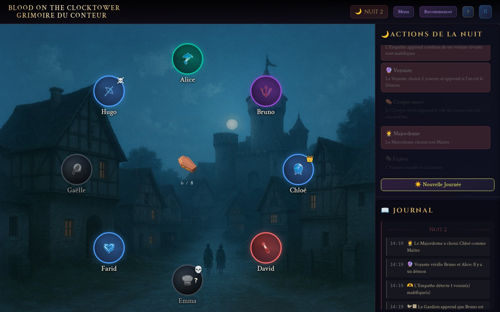

## Le jeu en bref

*Blood on the Clocktower* est un jeu de déduction sociale pour 5 à 15 joueurs, animé par un Conteur. Chaque joueur reçoit en secret un rôle doté d'une capacité, dans l'un des deux camps :

- **Le Village** (Villageois et Étrangers) doit trouver et exécuter le Démon.
- **Le Mal** (Sbires et Démon) connaît ses membres et doit survivre jusqu'à ce qu'il ne reste que deux joueurs en vie.

La partie alterne deux phases. La **nuit**, le Conteur réveille les rôles un par un, dans un ordre précis : certains obtiennent une information, d'autres empoisonnent, protègent ou tuent. Le **jour**, les joueurs débattent, se nominent et votent pour exécuter l'un d'entre eux.

Le Conteur est le seul à tout savoir. Son grimoire recense le rôle de chacun, qui est vivant, empoisonné ou protégé, et ce qui s'est passé chaque nuit. C'est ce grimoire que l'application remplace.

## Une partie pas à pas

Les captures ci-dessous viennent d'une vraie partie à 8 joueurs, jouée automatiquement par les tests (voir [Tests](#tests)).

### 1. Installer les joueurs

Le Conteur ajoute les joueurs, qui se placent en cercle comme autour de la table. À partir de 5 joueurs, le bouton « Assigner les rôles » apparaît.

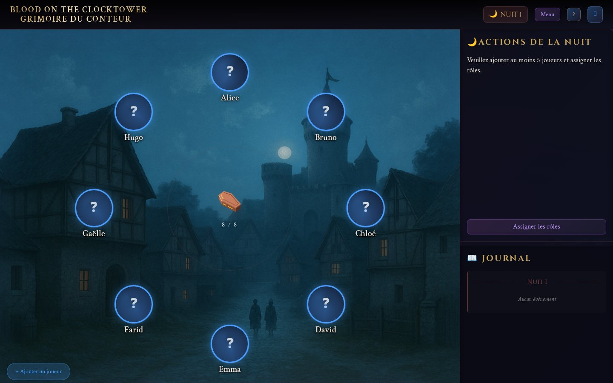

### 2. Distribuer les rôles

Les rôles sont tirés au sort en respectant la répartition officielle (ici 5 Villageois, 1 Étranger, 1 Sbire et 1 Démon). La couleur du jeton indique la catégorie : bleu pour les Villageois, vert pour les Étrangers, rouge pour les Sbires, violet pour le Démon. Le panneau de droite liste les rôles à réveiller ; ceux qui ne sont pas en jeu sont grisés.

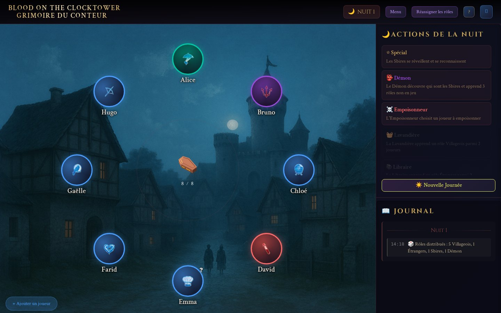

### 3. Suivre chaque joueur

Un clic sur un jeton ouvre la fiche du joueur : changement de rôle, statuts (vivant, exécuté, Leurre, Maître, ivre, empoisonné, protégé) et notes du Conteur.

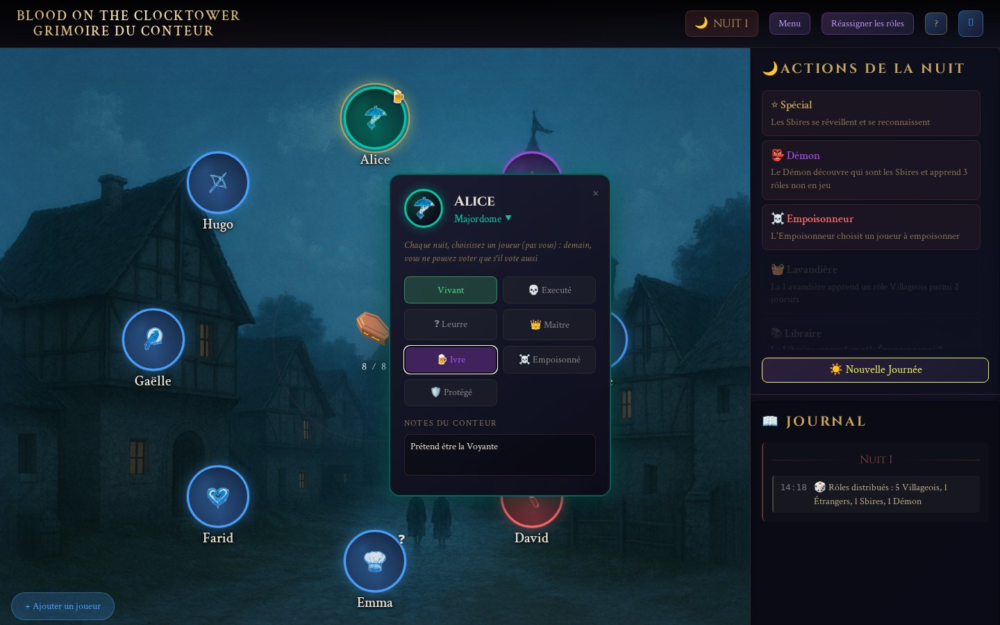

### 4. Jouer la nuit

Le Conteur clique sur chaque étape dans l'ordre. Quand un rôle doit désigner des joueurs, il suffit de cliquer sur leurs jetons puis de confirmer : l'application calcule le résultat et l'inscrit au journal. Ici, l'Empoisonneur a empoisonné Hugo (badge ☠️) et la Voyante désigne Alice et Bruno pour savoir si l'un d'eux est le Démon.

Un rôle empoisonné ou ivre reçoit une information fausse, signalée comme telle dans le journal.

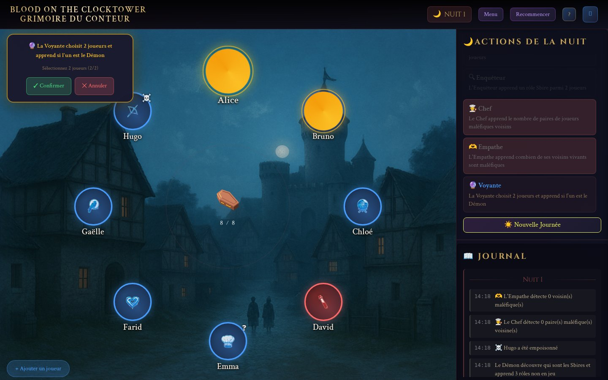

### 5. Jouer le jour

Au lever du soleil, le décor change et le panneau affiche les étapes de la journée. Après les débats et le vote, le Conteur clique sur le joueur exécuté, ou sur « Pas d'exécution ». La nuit suivante commence aussitôt.

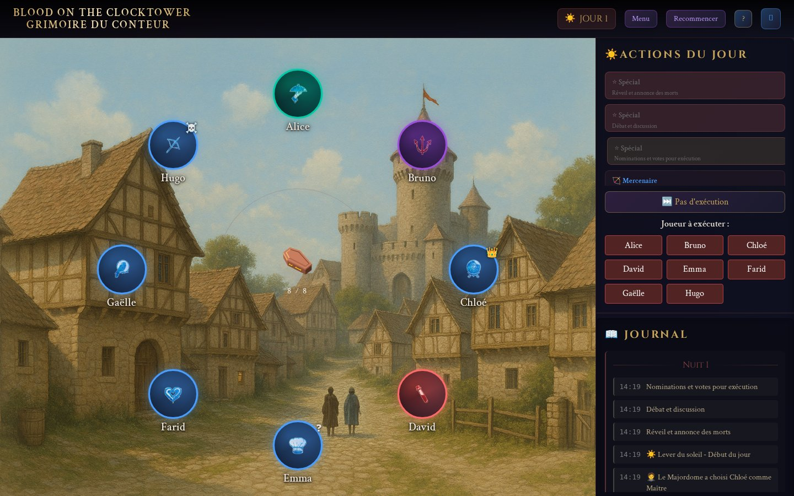

### 6. Les nuits suivantes

À partir de la deuxième nuit, le Démon tue. Les joueurs morts sont grisés et le compteur central indique le nombre de survivants. Dans cette partie, Emma a été exécutée le premier jour, puis le Démon a tué Gaëlle, le Gardien, qui apprend en mourant le rôle d'un joueur de son choix (c'est la capture en haut de cette page).

### 7. Fin de partie

L'application vérifie les conditions de victoire après chaque mort. Ici, le Village exécute Bruno, le Démon, le deuxième jour.

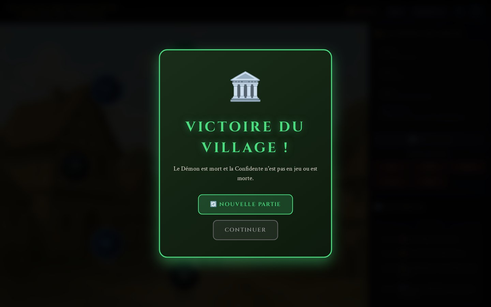

### Aide intégrée

Le bouton « ? » ouvre un guide du Conteur : règles, description des rôles, ordre de nuit et conditions de victoire.

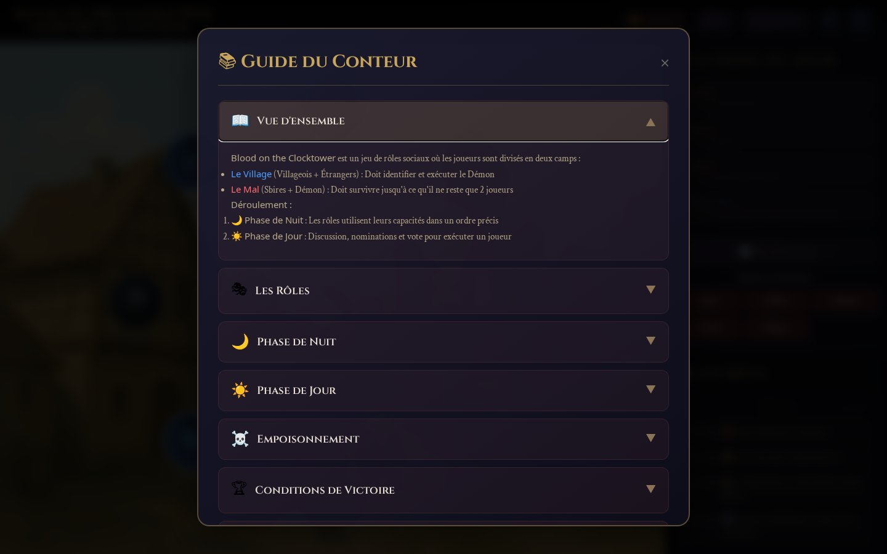

### De 5 à 15 joueurs, sur ordinateur ou téléphone

<p>
  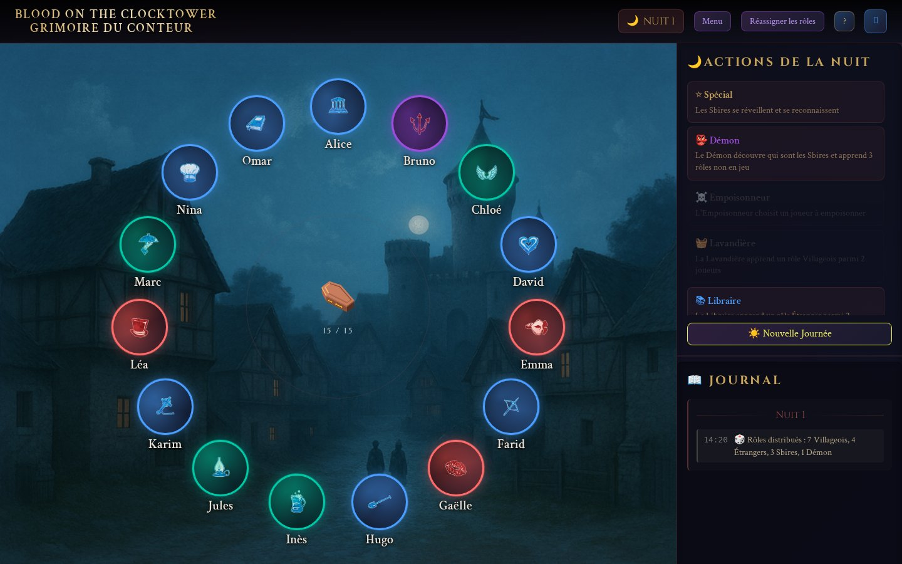
  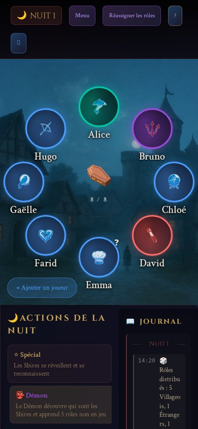
</p>

## Jouer à plusieurs

Au lancement, le Conteur choisit son mode de jeu. La partie locale correspond à tout ce qui précède. La partie multijoueur ouvre un salon que les joueurs rejoignent depuis leur téléphone ou leur ordinateur.

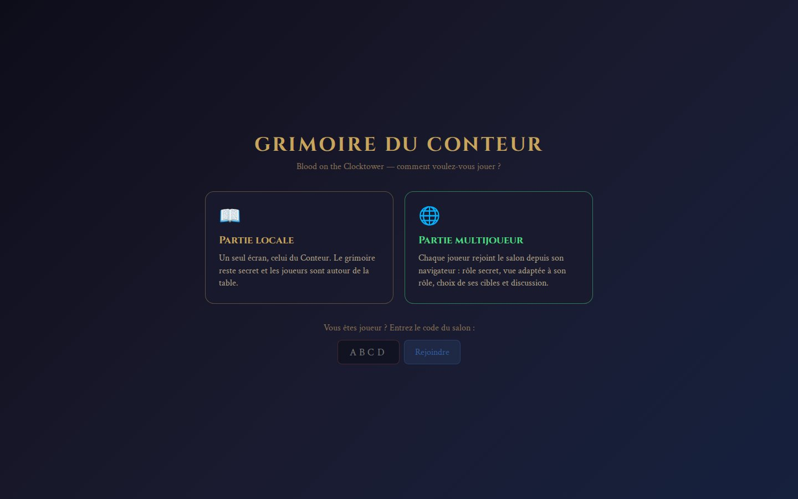

### Côté Conteur

Le Conteur garde le grimoire complet et mène la partie comme en local. Le code du salon s'affiche en haut de l'écran ; un clic dessus copie le lien d'invitation. Chaque joueur qui rejoint le salon prend place dans le cercle (il n'y a pas d'ajout manuel dans ce mode), et un onglet « Discussion » s'ajoute au journal.

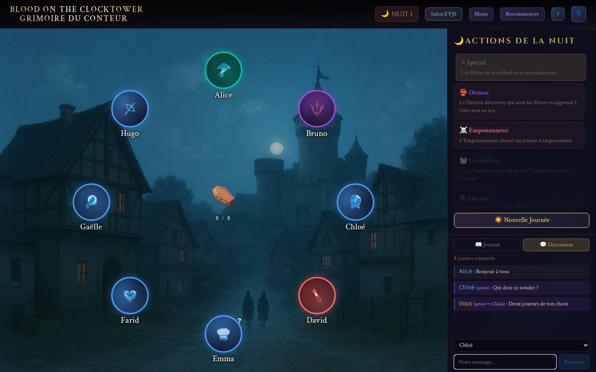

### Côté joueur

Chaque joueur ouvre le lien d'invitation (ou saisit le code du salon), entre son nom, et voit uniquement ce que son personnage sait :

| Qui | Ce qu'il voit |
| --- | --- |
| Tous les joueurs | Le cercle, la phase en cours, qui est mort, son propre rôle et sa description |
| Sbires et Démon | Les rôles de leurs complices |
| Démon | Trois rôles absents de la partie, pour bluffer |
| Espion | Tout le grimoire : rôles et statuts de chacun |
| Soûlard | Un rôle de Villageois : il ignore qu'il est Soûlard |
| Rôles à information | Le résultat de leur capacité, dans « Vos informations », sans indication d'empoisonnement |

Les droits suivent les règles du jeu :

- **Capacités** : quand le Conteur réveille un rôle qui doit désigner des joueurs, la demande apparaît sur l'écran du joueur concerné. Il touche ses cibles et valide ; le Conteur confirme et l'application résout la capacité.
- **Morts de la nuit** : elles restent secrètes jusqu'au lever du jour. Les exécutions sont visibles immédiatement.
- **Discussion** : ouverte à tous le jour. La nuit, un joueur ne peut écrire qu'au Conteur, en privé ; le Conteur peut répondre en privé à n'importe quel joueur.
- **Fin de partie** : le vainqueur et tous les rôles sont révélés à tout le monde.

Ici, la Voyante choisit les deux joueurs qu'elle veut sonder :

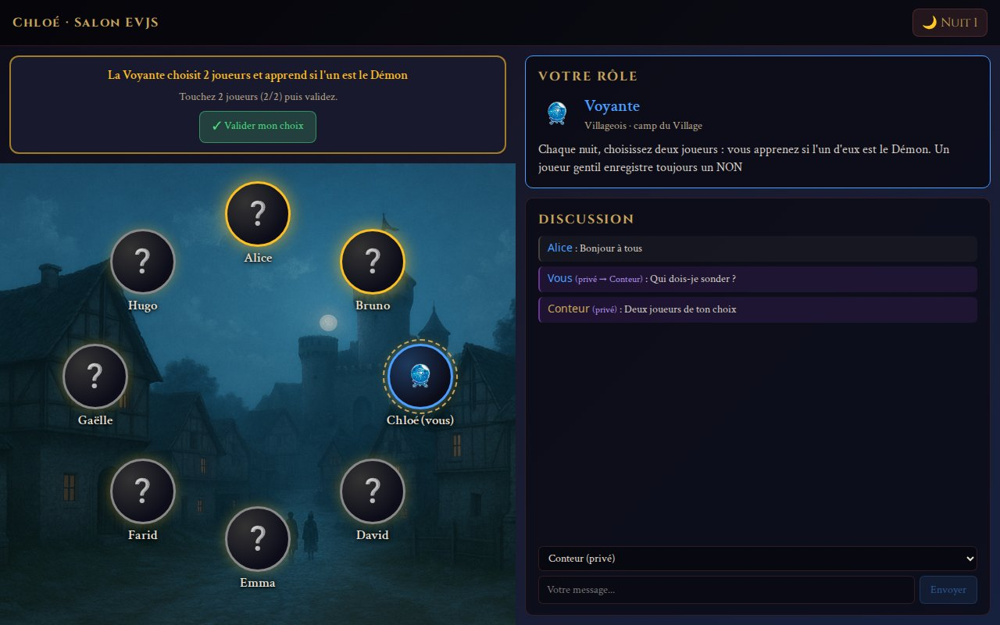

Le Démon, lui, connaît son Sbire et reçoit ses trois bluffs :

<p>
  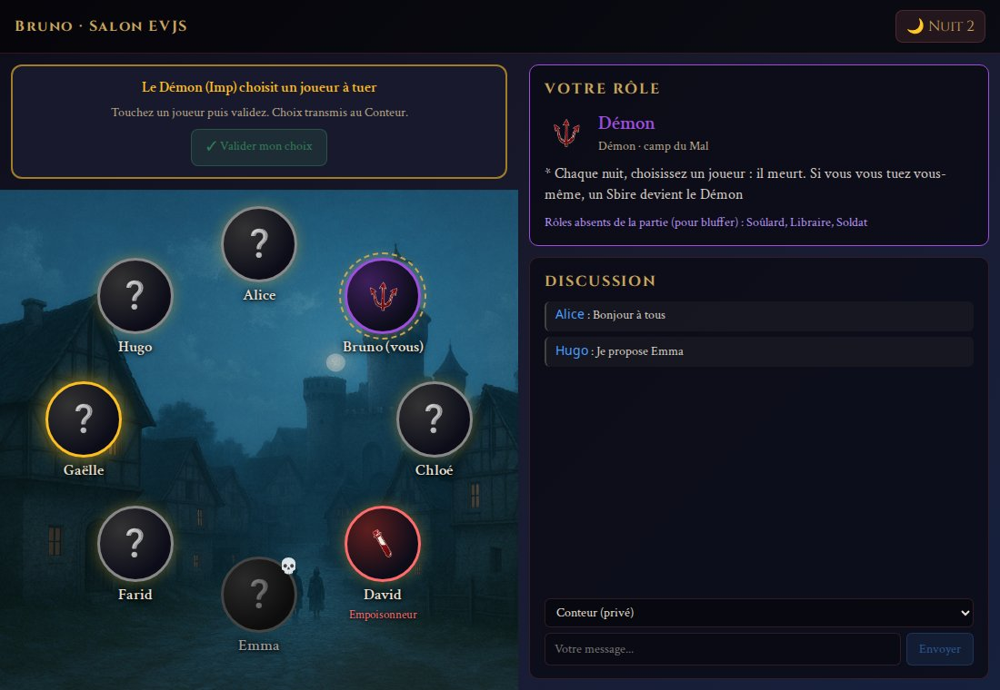
  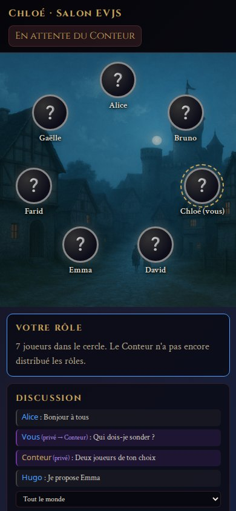
</p>

### Fonctionnement et limites

- Le salon se ferme dès que les rôles sont distribués : plus personne ne peut rejoindre la partie. Un joueur déjà installé, ou le Conteur, qui recharge sa page ou perd sa connexion retrouve sa place.
- Un joueur retiré du cercle par le Conteur est déconnecté et en est informé sur son écran.
- La partie tourne dans le navigateur du Conteur, qui calcule ce que chaque joueur a le droit de voir. Le serveur relaie ces vues, sans jamais envoyer le grimoire complet à un joueur.
- Les salons sont gardés en mémoire : ils disparaissent si le serveur redémarre.
- Les nominations et les votes se font à la voix ou dans la discussion ; le Conteur enregistre l'exécution.
- Le Soûlard n'est pas réveillé la nuit à la place du rôle qu'il croit avoir : le Conteur lui envoie sa fausse information par message privé.

## Fonctionnalités

- **Cercle des joueurs** : ajout des joueurs, jetons disposés en cercle et déplaçables à la souris ou au doigt.
- **Rôles** : distribution automatique des rôles ou attribution manuelle, avec les 22 rôles de *Trouble Brewing* (Villageois, Étrangers, Sbires, Démon).
- **États des joueurs** : mort, exécuté, empoisonné, protégé, ivre, capacité utilisée, notes libres.
- **Ordre de nuit** : liste des rôles à réveiller pour la première nuit et les suivantes, avec suivi des actions effectuées.
- **Actions guidées** : sélection des cibles et résolution des capacités (Empoisonneur, Moine, Démon, Voyante, Mercenaire, etc.).
- **Journal** : historique des événements, nuit par nuit.
- **Conditions de victoire** : détection de la fin de partie et annonce du camp vainqueur.
- **Aide intégrée** : rappel des règles, des rôles et de l'ordre de nuit.
- **Sauvegarde automatique** : la partie est conservée dans le navigateur (`localStorage`) et survit à un rechargement de la page.
- **Mode plein écran** et alternance visuelle jour / nuit.
- **Multijoueur** : salon à rejoindre par code ou par lien, vue de chaque joueur selon son rôle, choix des cibles sur son propre écran, discussion publique et privée.

## Démarrage

Prérequis : [Node.js](https://nodejs.org/) 20 ou plus récent.

```bash
git clone https://github.com/legcs/BOTC-server.git
cd BOTC-server
npm install
npm run dev
```

L'application est alors disponible sur `http://localhost:5173`. Le serveur écoute aussi sur le réseau local : en multijoueur, les joueurs connectés au même réseau rejoignent la partie avec l'adresse « Network » affichée au démarrage.

Pour un usage hors développement, construisez l'application puis lancez le serveur, qui sert à la fois les pages et le relais multijoueur :

```bash
npm run build
npm start          # http://localhost:3000, ou PORT=8080 npm start
```

Le multijoueur a besoin de ce serveur Node (connexions WebSocket) : un hébergement purement statique ne suffit que pour la partie locale.

## Scripts

| Commande | Rôle |
| --- | --- |
| `npm run dev` | Lance le serveur de développement avec rechargement à chaud |
| `npm run build` | Génère la version de production dans `dist/` |
| `npm run preview` | Sert localement la version de production |
| `npm start` | Lance le serveur de production (application et relais multijoueur) |
| `npm run lint` | Analyse le code avec ESLint |
| `npm run test:e2e` | Lance les tests de bout en bout et régénère les captures |

## Tests

Les tests de bout en bout pilotent l'application dans un vrai navigateur avec [Playwright](https://playwright.dev/) :

```bash
npx playwright install chromium   # une seule fois
npm run test:e2e
```

Le script `tests/e2e.mjs` démarre son propre serveur Vite, puis :

- joue une partie complète à 8 joueurs, de l'ajout des joueurs à la victoire, en vérifiant l'état du grimoire à chaque étape ;
- vérifie les règles une par une à partir de parties préparées : Moine, Soldat, Voyante et Leurre, Empathe, Gardien, Croque-mort, Mercenaire, Majordome, Confidente, Saint, Maire, poison et conditions de victoire ;
- contrôle la répartition des rôles de 5 à 15 joueurs, la sauvegarde après rechargement et l'affichage sur téléphone ;
- joue une partie multijoueur avec 9 navigateurs (un Conteur et 8 joueurs) : synchronisation, vue de chaque rôle, choix des cibles, discussion publique et privée, secret des morts de nuit, reconnexion ;
- régénère les captures d'écran de ce README dans `Documentation/screenshots/`.

Le tirage des rôles utilise une graine fixe, donc la partie jouée et les captures sont reproductibles. `SEED=41 npm run test:e2e` joue une autre distribution.

## Structure du projet

```
src/
├── Root.jsx             Choix du mode de jeu
├── App.jsx              Grimoire du Conteur : état de la partie et orchestration
├── components/          Interface (en-tête, grimoire, jetons, panneaux, modales)
│   └── roles/           Logique de la capacité de chaque rôle
├── multiplayer/         Vue des joueurs, connexion au relais, calcul des vues par rôle
├── data/                Rôles, ordre de nuit, conditions de victoire
├── utils/               Règles du jeu, placement des jetons, sauvegarde
└── styles/              Styles globaux
public/images/           Icônes des rôles et fonds jour / nuit
server/                  Relais multijoueur (WebSocket) et serveur de production
tests/e2e.mjs            Tests de bout en bout (Playwright)
Documentation/           Notes sur la refactorisation et captures d'écran
```

## Technologies

- [React 19](https://react.dev/)
- [Vite 7](https://vite.dev/)
- [lucide-react](https://lucide.dev/) pour les icônes d'interface
- [ws](https://github.com/websockets/ws) pour le relais multijoueur
- [Playwright](https://playwright.dev/) pour les tests

## Avertissement

Projet de fan non officiel, sans lien avec The Pandemonium Institute. *Blood on the Clocktower* est une marque de The Pandemonium Institute.
